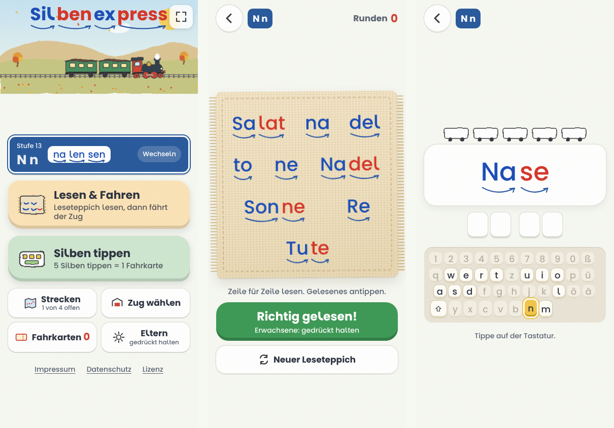

# 🚂 Silbenexpress
**Silbenexpress** ist ein Zugspiel im Browser, mit dem Kinder silbisch lesen lernen. Kinder lesen einen bunten Leseteppich aus Silben. Ein Erwachsener bestätigt, dass richtig gelesen wurde. Dann darf das Kind seinen Zug selbst losfahren lassen.
Die Silben sind farbig (blau und rot im Wechsel) und haben Silbenbögen, angelehnt an die im Erstleseunterricht verbreitete Silbenmethode.

## Funktionen
- **Lesen & Fahren:** Es wird ein zufälliger Leseteppich aus Silben und Wörtern erzeugt. Etwa die Hälfte übt die neuen Buchstaben, der Rest wiederholt. Ein Erwachsener hält „Richtig gelesen!“ gedrückt, dann startet das Kind die Fahrt mit dem großen „Los!“-Knopf.
- **Silben tippen:** Das Kind tippt Silben und Wörter auf der Computertastatur nach. Die nächste Taste leuchtet auf einer abgebildeten deutschen Tastatur. Auf Tablet und Handy werden die Tasten angetippt. Nach 5 Silben gibt es eine Fahrkarte.
- **39 Buchstaben-Stufen:** Die Stufen führen von „m u“ bis „X x chs“, mit Wiederholungsstufen. Wörter erscheinen nur, wenn alle Buchstaben darin schon dran waren. Großbuchstaben erscheinen erst, wenn sie eingeführt sind.
- **Sechs Züge:** Dampflok, ICE, Regionalbahn, Regionalexpress, Güterzug und Bimmelbahn.
- **Vier Strecken:** Wiesenbahn, Seebahn, Bergbahn und Küstenbahn. Sie werden durch gefahrene Runden freigeschaltet.
- **Jahres- und Tageszeiten:** Frühling, Sommer, Herbst und Winter sowie Morgen, Tag, Abend und Nacht. Wahlweise passt sich das Bild an Datum und Uhrzeit des Geräts an.
- **Elternmenü:** Wird mit 1 Sekunde gedrückt Halten geöffnet. Dort lassen sich einstellen:
  - Größe und Inhalt des Leseteppichs
  - Tastenhilfe und Umschalttaste
  - Strecken, Jahres- und Tageszeit
  - Ton
  - Speichern auf dem Gerät
  - Vollbild
- **Klänge:** Alle Geräusche werden im Browser erzeugt (Web Audio), es gibt keine Audiodateien.
- **Bilder:** Grafiken im Wasserfarben-Stil als eingebettetes SVG.

## Datenschutz
Der Silbenexpress ist auf Datensparsamkeit ausgelegt:
- keine Cookies, kein Tracking, keine Analyse, keine Werbung, kein Konto
- keine Inhalte von fremden Servern: Schrift, Grafiken und Klänge stecken in der Datei selbst
- Spielstand (Stufe, Zug, Strecke, Einstellungen, Runden, Fahrkarten) wird nur nach Einwilligung im `localStorage` des Browsers gespeichert und verlässt das Gerät nicht
- keine Erfassung von Namen, Fotos oder Tonaufnahmen

Beim Hosting über GitHub Pages verarbeitet GitHub technisch notwendige Zugriffsdaten (z. B. IP-Adresse). Details stehen in der Datenschutzerklärung in der App.

## Aufbau
Die ganze App steckt in einer einzigen Datei, `index.html`, mit HTML, CSS und JavaScript ohne Frameworks und ohne Build-Schritt. Die Schrift ist als WOFF eingebettet.
Die Anwendung kann zur Offline-Nutzung heruntergeladen und mit Hilfe eines aktuellen Browsers genutzt werden.

## Lizenz
CC-BY-SA 4.0 Sebastian Wolf (2026)
Programm, Grafiken, Texte und Wortlisten stehen unter der Lizenz [Creative Commons Namensnennung – Weitergabe unter gleichen Bedingungen 4.0 International (CC BY-SA 4.0)](https://creativecommons.org/licenses/by-sa/4.0/deed.de).
Namensnennung bei Weitergabe: *„Silbenexpress“ von Sebastian Wolf, Lizenz CC BY-SA 4.0*
**Schrift:** Die eingebettete Schrift „Silbenschrift“ beruht auf [Poppins](https://github.com/itfoundry/Poppins), Copyright 2020 The Poppins Project Authors. Sie steht unter der [SIL Open Font License 1.1](https://openfontlicense.org). Verändert wurden das kleine l (mit Bogen, zur Unterscheidung vom großen I) und der Zeichenumfang.
**Silbenmethode:** Die farbige Silbendarstellung lehnt sich an die verbreitete Silbenmethode im Erstleseunterricht an. Buchstabenfolge, Wortlisten, Silben und Grafiken sind eigene Zusammenstellungen. Es besteht keine Verbindung zu einem Verlag oder Lehrwerk.
**Transparenzhinweis:** Die Anwendung wurde mit Hilfe der KI Claude Opus 5.5 erstellt. 

## Kontakt
Sebastian Wolf · s.w.oer@outlook.de
Impressum und Datenschutzerklärung stehen in der App.
